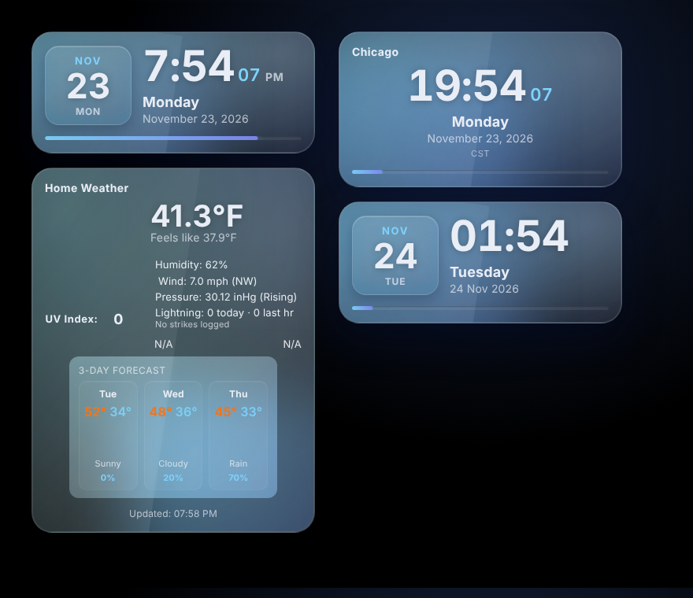

# MMM-GlassClock

A liquid-glass clock card for MagicMirror². It shows the time, weekday, month, day and year, and is
styled to sit next to [MMM-GlassTempest](https://github.com/scottshaffer/MMM-GlassTempest): same glass
card, shimmer, colors and theme variables.



## Features

- Time in 12- or 24-hour format, with optional seconds and AM/PM
- Calendar tile (month, day, weekday) plus the full weekday and date
- Any locale and any time zone, using the browser's built-in `Intl` (no npm packages)
- Liquid progress bar that fills over the day (or over each minute)
- Standard layout (tile + time) or compact layout (centered)
- Follows your theme's `--mm-text`, `--mm-text-2`, `--mm-accent-2` and `body.mm-day` day mode
- Light on the CPU: only changed text is updated, ticks stop while the card is hidden (MMM-pages),
  and the Pi profile turns the shimmer animations off

## Installation

```bash
cd ~/MagicMirror/modules
git clone https://github.com/scottshaffer/MMM-GlassClock.git
```

There is nothing to `npm install`.

## Configuration

Put it in the same region as MMM-GlassTempest, above it, so the two cards stack with matching widths:

```js
{
  module: "MMM-GlassClock",
  position: "top_right",
  config: {
    timeZone: "America/Chicago"
  }
},
{
  module: "MMM-GlassTempest",
  position: "top_right",
  config: { /* ... */ }
},
```

If you use MagicMirror's built-in `clock` module, disable it so you don't show two clocks.

### Sample config entry

A complete entry with every option at its default (plus a time zone), ready to paste into the
`modules: [ ... ]` array of `~/MagicMirror/config/config.js`. Delete any line you don't need to change.

```js
{
  module: "MMM-GlassClock",
  position: "top_right",
  config: {
    title: "",                     // "" hides the title
    layout: "standard",            // "standard" | "compact"

    // Time
    timeFormat: null,              // 12 | 24 | null (use MagicMirror's timeFormat)
    showSeconds: true,
    showAmPm: true,
    leadingZero: false,
    blinkColon: false,

    // Date
    showDateTile: true,
    showWeekday: true,
    showDate: true,
    showYear: true,
    dateFormat: "long",            // "long" | "medium" | "short"

    // Locale and time zone
    locale: null,                  // null = MagicMirror's language
    timeZone: "America/Chicago",   // null = the system time zone
    showTimeZone: false,

    // Extras
    progressBar: "day",            // "day" | "minute" | "none"
    minWidth: 260,
    maxWidth: 380,
    performanceProfile: "auto",    // "auto" | "pi" | "full"
    reduceMotion: false
  }
},
```

### Options

| Option | Default | Description |
| :-- | :-- | :-- |
| `title` | `""` | Card title in the GlassTempest style; `""` hides it |
| `layout` | `"standard"` | `"standard"` (calendar tile + time) or `"compact"` (centered) |
| `timeFormat` | `null` | `12` or `24`; `null` follows MagicMirror's global `timeFormat` |
| `showSeconds` | `true` | Small accent-colored seconds next to the time |
| `showAmPm` | `true` | AM/PM in 12-hour mode |
| `leadingZero` | `false` | `09:05` instead of `9:05` in 12-hour mode |
| `blinkColon` | `false` | Gentle pulse on the time (off under reduced motion) |
| `showDateTile` | `true` | Calendar tile; `false` gives the compact layout |
| `showWeekday` | `true` | Full weekday under the time (and short weekday in the tile) |
| `showDate` | `true` | Date line |
| `showYear` | `true` | Include the year in the date line |
| `dateFormat` | `"long"` | `"long"` (November 23, 2026), `"medium"` (Nov 23, 2026), `"short"` (11/23/2026) |
| `locale` | `null` | e.g. `"en-GB"`, `"de"`; `null` follows MagicMirror's `language` |
| `timeZone` | `null` | IANA zone such as `"America/Chicago"`; `null` uses the system zone |
| `showTimeZone` | `false` | Zone abbreviation (e.g. CST) under the date |
| `progressBar` | `"day"` | `"day"`, `"minute"` or `"none"` |
| `minWidth` / `maxWidth` | `260` / `380` | Card width limits in px (same as GlassTempest) |
| `performanceProfile` | `"auto"` | `"auto"`, `"pi"` (no animation) or `"full"` |
| `reduceMotion` | `false` | Turn off the shimmer and other motion |

Locale formats differ: the order of the date and the AM/PM text come from the locale (for example
`"de"` gives `Montag` and `23. November 2026`).

### A world clock

Add the module more than once, each with its own zone and a title:

```js
{ module: "MMM-GlassClock", position: "top_left",
  config: { title: "London", timeZone: "Europe/London", layout: "compact", showTimeZone: true } },
```

## Tests

```bash
npm test
```

## Credits

- Liquid-glass card recipe from [MMM-AmbientWeather](https://github.com/hearter20176/MMM-AmbientWeather)
  by Harry Arter (MIT), as used in MMM-GlassTempest.

## License

MIT, see `LICENSE`.
